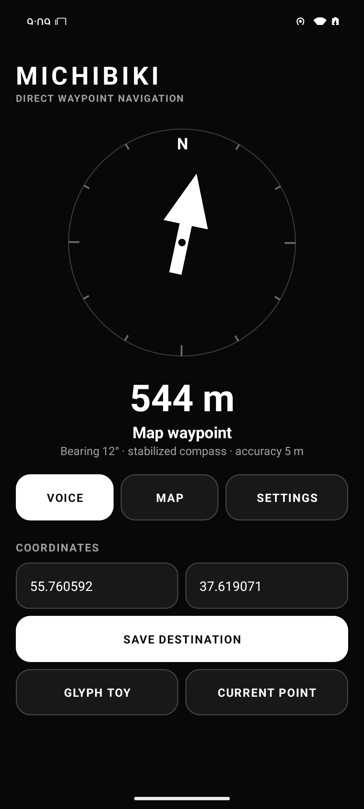
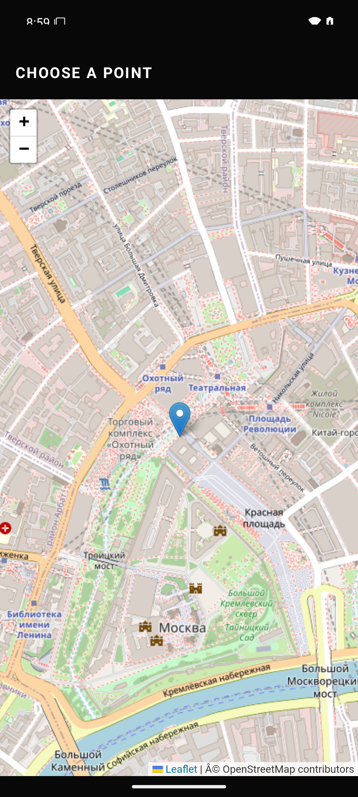
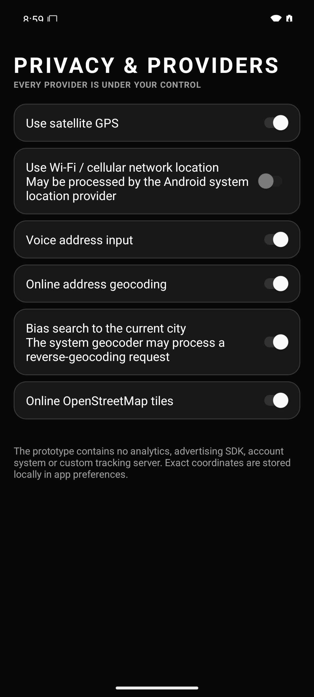
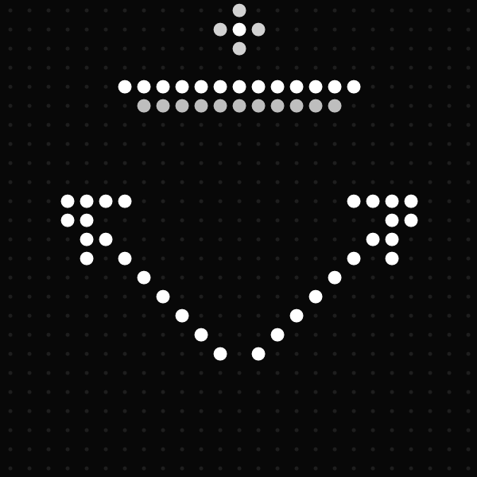

# Michibiki Compass

An early, privacy-first waypoint compass for Nothing phones. Choose a point, then glance at the app, the 4×2 widget, or the Glyph Matrix instead of keeping a full map open.

> **Prototype:** this build is meant for hands-on testing. It is not yet a turn-by-turn navigator and must not be relied on for safety-critical navigation.

## What works

- search for a destination by voice or text, with ambiguous results shown for confirmation;
- choose a point directly on the built-in map;
- keep location processing on the phone, with separate controls for GPS and network location;
- show north independently from the destination direction;
- prefer GNSS course while moving and a filtered compass while stationary;
- reject sudden compass spikes and smooth ordinary sensor noise;
- show destination direction and distance in the app and 4×2 widget;
- run as a Glyph Toy, with a bright four-pixel north star;
- long-press the Glyph Toy to preview obstacle/detour mode;
- render natively on both supported Glyph Matrix sizes.

## Glyph compatibility

| Device | Matrix | Support |
|---|---:|---|
| Nothing Phone (3) | 25×25 | Interactive Glyph Toy, including long press |
| Nothing Phone (4a) Pro | 13×13 | AOD-compatible display; artwork is simplified to remain readable |
| Phone (1), Phone (2), Phone (2a), Phone (3a) series | LED strips | Not yet supported; these require the separate classic Glyph SDK |

The current obstacle preview draws the boundary near the outer edge and rotates it independently from the route arrow. Until map/routing geometry is added, its wall direction is estimated as perpendicular to the direct bearing to the destination.

## Build

Requirements: JDK 17 and Android SDK 35.

1. Download the official `glyph-matrix-sdk-2.0.aar` from Nothing's [Glyph Matrix Developer Kit](https://github.com/Nothing-Developer-Programme/GlyphMatrix-Developer-Kit).
2. Place it at `app/libs/glyph-matrix-sdk-2.0.aar`.
3. Create `local.properties` with your Android SDK path.
4. Run `./gradlew assembleDebug` (or `gradlew.bat assembleDebug` on Windows).

The SDK AAR is intentionally excluded from this repository because it is governed by Nothing's separate proprietary licence and cannot be redistributed here. See [THIRD_PARTY_NOTICES.md](THIRD_PARTY_NOTICES.md).

## Screenshots

| Compass | Point picker | Settings |
|---|---|---|
|  |  |  |

## Privacy

Location is used for navigation and saved locally in Android preferences. Michibiki does not include analytics, advertising, or its own tracking backend. Android's geocoder, speech recognizer, map tiles, and network-location provider may contact their respective service providers when enabled.

## Licence

No open-source licence has been granted for Michibiki yet. The Nothing Glyph Matrix SDK is separately licensed by Nothing Technology Limited and is not part of this repository.

